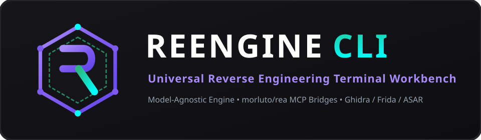

# ReEngine CLI

> **Universal, Model-Agnostic Reverse Engineering Terminal Workbench**  
> Uniting a Claude-Code-grade Ink/React TUI with the built-in `morluto/rea` (`rea-agents`) Reverse Engineer Anything MCP engine.

[](https://www.typescriptlang.org/)
[](https://nodejs.org/)
[](https://opensource.org/licenses/MIT)
[](https://github.com/reengine-cli/reengine)

<p align="center">
  
</p>

---

## ⚡ Highlights

* **Zero-Friction REA Engine:** Embedded supervision of `morluto/rea` (`rea-agents`) with automatic discovery of local disassembly bridges (**Ghidra**, **IDA Pro**, **Hopper**, **Frida**, **Kuna**, **Cutter**, **GDB**, **JADX**, **Playwright**) and zero-dependency JS/Electron/ASAR inspection.
* **Instant Standalone Binary:** Ships as a self-contained single executable (`reengine.exe`) added directly to your system `PATH` — launch globally from any PowerShell, CMD, or Windows Terminal simply by typing `reengine`, matching the seamless developer ergonomics of `opencode` and `claude-code`.
* **Evidence-First UI:** Large disassembly listings, symbol tables, and ASTs never flood your terminal. Compact, collapsible **Tool Cards** with live timers and expandable **Evidence & Coverage Drawers** keep your workspace clean and structured.
* **Universal Model Freedom:** Zero vendor lock-in. Connect to **OpenRouter**, **Anthropic**, **OpenAI**, **Google Gemini**, local **Ollama** (`qwen2.5-coder`, `deepseek-r1`), `llama.cpp` / `llama-server`, or any custom OpenAI-compatible API endpoint.
* **Terminal-Honest Customization:** 6 curated themes (`obsidian-minimal`, `nord-slate`, `solar-carbon`, `alabaster-zen`, `high-contrast`, `monochrome-ansi`), TrueColor 24-bit HEX palettes, density scaling, glyph packs, and terminal profile exporters for Windows Terminal, Ghostty, WezTerm, and iTerm2.
* **Enterprise Security & Redaction:** Strict permission tiering (`ask`, `auto-read`, `strict`, `sandbox`), automatic secret redaction (`sk-...`, tokens, passwords), and clean child process watchdog management with zero zombie processes.

---

## 🚀 Quick Start

### 1. Global Terminal Access (Standalone Executable)

ReEngine is installed in your user path under `%USERPROFILE%\.reengine\bin` and accessible from **any terminal** globally:

```powershell
# Verify installation from any directory or new terminal
reengine --version
reengine doctor
```

Simply type `reengine` in any shell to launch the interactive reverse engineering workbench:

```powershell
# Open interactive TUI on current directory
reengine

# Open interactive TUI targeting a specific binary, directory, APK, or ASAR
reengine ./target.exe
reengine ./resources/app.asar
reengine ./firmware.bin
```

---

### 2. Alternative Installation Options

#### Via Node Package Manager (NPM / PNPM)

```bash
# Install globally via npm
npm install -g @reengine/cli

# Or run directly on demand without installing
npx @reengine/cli ./target.exe
```

---

## 🩺 System & Engine Diagnostics (`reengine doctor`)

Before analyzing targets, run the built-in diagnostic suite to verify your environment, active LLM keys, and detected local reverse engineering engines:

```bash
reengine doctor
```

Sample output:

```text
=== ReEngine CLI Doctor Diagnostic Report ===
Timestamp: 2026-11-24T15:28:40.055Z

[1] Runtime Environment:
  • Node.js: v24.15.0 (✓ Supported)
  • Terminal: Windows Terminal (80x24, TrueColor: Yes)

[2] REA MCP Backend:
  • Resolved via: system (C:\Users\...\AppData\Roaming\npm\rea-agents)
  • Engines:
    - [JS/ASAR] ✓ Ready (Built-in zero-dependency extractor)
    - [GHIDRA]  ✓ Ready (E:\ghidra_12.1.3_PUBLIC)
    - [FRIDA]   ✓ Ready (C:\Python\bin\frida.exe)
    - [IDA]     - Not found in PATH
    - [HOPPER]  - Not found in PATH
    - [CUTTER]  - Not found in PATH
    - [GDB]     - Not found in PATH
    - [JADX]    - Not found in PATH

[3] Configured LLM Providers:
  • openrouter (openrouter): Model=anthropic/claude-3.7-sonnet, API Key=Configured
  • anthropic (anthropic):   Model=claude-3-7-sonnet-20250219, API Key=Configured
  • openai (openai):         Model=gpt-4o, API Key=Missing Env
  • ollama (ollama):         Model=qwen2.5-coder:7b, API Key=Configured
```

To integrate with CI/CD pipelines or automated shell scripts, request JSON output:

```bash
reengine doctor --json
```

---

## 🤖 Headless & Automated CI/CD Mode (`reengine run`)

ReEngine can execute automated reverse engineering audits and queries headlessly without launching the interactive TUI. Ideal for scripts, pre-commit checks, and automated security scans:

```bash
# Analyze an Electron application ASAR archive
reengine run "Trace Electron IPC validation logic and extract license checks" \
  --target ./app.asar \
  --format markdown \
  --auto-approve-read

# Audit an ELF / PE binary with Ghidra bridge
reengine run "Identify cryptographic constants and export call graph around sub_401000" \
  --target ./malware_sample.exe \
  --provider anthropic \
  --model claude-3-7-sonnet-20250219
```

Supported output formats: `--format text | json | markdown`.

---

## ⌨️ Interactive TUI Manual

### Slash Commands

| Command | Description |
| :--- | :--- |
| `/help` | View complete interactive command guide and active keybindings |
| `/model [id]` | Switch active model or assign Fast vs Primary roles |
| `/provider [id]` | Switch active LLM provider (Anthropic, OpenRouter, OpenAI, Ollama) |
| `/mcp` | Inspect live MCP supervisor status, tool schemas, and local engines |
| `/evidence` | Inspect verified evidence records, artifacts, and reconstruction coverage |
| `/theme [name]` | Open live hot-reload Theme Studio or apply theme preset |
| `/session` | View current session telemetry, tokens consumed, and duration |
| `/export [path]` | Export current investigation session to clean Markdown |
| `/clear` | Clear visible terminal scrollback and conversation buffer |
| `/quit` | Terminate all child processes cleanly and exit ReEngine |

### Keyboard Shortcuts

* <kbd>Ctrl</kbd> + <kbd>C</kbd> — Cancel active model generation or tool execution; press twice within 1 second to exit cleanly.
* <kbd>Ctrl</kbd> + <kbd>O</kbd> — Expand or collapse the latest Tool Execution Card or Evidence Drawer.
* <kbd>Ctrl</kbd> + <kbd>K</kbd> — Open the instant Command Palette.
* <kbd>Tab</kbd> — Autocomplete `@file` / `@dir` references or `/` slash commands.
* <kbd>Shift</kbd> + <kbd>Enter</kbd> — Insert newline in prompt composer without submitting.
* <kbd>Esc</kbd> — Dismiss open dialogs, modals, or autocomplete popups.

### Direct `@` File & Directory References

Type `@` in the prompt composer to trigger fuzzy path auto-completion:

```text
> Analyze the cryptographic routines in @src/crypto/verify.c and correlate with @dist/binary.exe
```

---

## 🎨 Theme & Terminal Profile Management

ReEngine ships with 6 high-contrast, terminal-tested themes and can generate native terminal configuration snippets matching your chosen aesthetic:

```bash
# List all available themes
reengine theme list

# Apply a theme globally or to local workspace
reengine theme apply nord-slate

# Export native profile snippet for your terminal emulator
reengine ui apply-terminal wt        # Windows Terminal (JSON fragment)
reengine ui apply-terminal ghostty   # Ghostty config
reengine ui apply-terminal wezterm   # WezTerm Lua snippet
```

Available curated themes:
1. `obsidian-minimal` (Default: Charcoal surface, violet accent, dark slate borders)
2. `nord-slate` (Nordic arctic blue, cool frost accents, deep polarized slate)
3. `solar-carbon` (Solarized dark cyan, deep navy base)
4. `alabaster-zen` (Clean light mode, high readability paper tone, royal blue)
5. `high-contrast` (Pure black background, neon cyan accent, crisp borders)
6. `monochrome-ansi` (Pure monochrome styling for legacy ANSI terminals)

---

## ⚙️ Configuration Hierarchy

ReEngine CLI uses a 4-tier layered configuration system:

1. **CLI Flags** (e.g. `--provider`, `--model`, `--theme`)
2. **Local Workspace Config** (`./.reengine/config.json`)
3. **User Global Config** (`%USERPROFILE%/.reengine/config.json` or `~/.reengine/config.json`)
4. **Hardcoded Defaults**

### Example `.reengine/config.json`

```json
{
  "activeProviderId": "openrouter",
  "activeModel": "anthropic/claude-3.7-sonnet",
  "fastModel": "google/gemini-2.5-flash",
  "permissionMode": "auto-read",
  "ui": {
    "theme": "obsidian-minimal",
    "density": "balanced",
    "useNerdFonts": true
  },
  "providers": [
    {
      "id": "openrouter",
      "kind": "openrouter",
      "apiKeyEnvVar": "OPENROUTER_API_KEY",
      "defaultModel": "anthropic/claude-3.7-sonnet"
    },
    {
      "id": "ollama",
      "kind": "ollama",
      "baseUrl": "http://127.0.0.1:11434",
      "defaultModel": "qwen2.5-coder:7b"
    }
  ]
}
```

---

## 🏗 Repository Architecture

The codebase is organized as a strict, zero-warning TypeScript monorepo managed with `pnpm` and `Node.js 22+ LTS`:

```text
reengine-cli/
├── AGENTS.md                 # Autonomous engineering directive & guidelines
├── package.json              # Monorepo root configuration & release scripts
├── pnpm-workspace.yaml       # Workspace definition
├── tsconfig.base.json        # Strict TypeScript 5.8+ base configuration
├── docs/                     # Specifications, requirements, and architecture docs
├── scripts/
│   └── build-exe.mjs         # Node Single Executable Application (SEA) compiler
├── packages/
│   ├── core/                 # EventBus, Config, PermissionEngine, SecretRedactor, Session
│   ├── providers/            # Universal Provider Adapters (Anthropic, OpenAI, OpenRouter, Ollama)
│   ├── mcp-rea/              # REA MCP Supervisor, Engine Discovery, EvidenceStore, Spillover
│   ├── ui/                   # Ink/React TUI, Components, Themes, Hooks, TerminalProfileBridge
│   └── cli/                  # Command dispatcher, Doctor diagnostics, and Headless runner
└── tests/
    ├── unit/                 # Core, Provider, and CLI unit test suites (Vitest)
    ├── integration/          # REA MCP Engine discovery and Artifact spillover suites
    └── tui/                  # Terminal profile and theme rendering tests
```

---

## 🛠 Building From Source

### Prerequisites
* **Node.js 22+ LTS** (or v24+)
* **pnpm 9+**

```bash
# Clone the repository
git clone https://github.com/reengine-cli/reengine.git
cd reengine

# Install dependencies
pnpm install

# Build all workspace packages
pnpm build

# Run comprehensive test suite
pnpm test

# Run code linter & typechecker
pnpm lint
pnpm typecheck

# Compile single standalone executable (dist-exe/reengine.exe)
pnpm run build:exe
```

---

## 🛡 Security & Privacy

* **Local-First & Private:** ReEngine executes 100% locally on your machine. No telemetry or binary payloads are transmitted to any central cloud service.
* **Strict Permission Engine:** Read operations (file reads, symbol listings, disassembly) run under `auto-read` mode by default, while any destructive or active runtime hooks (memory writes, Frida scripts, shell executions) demand interactive confirmation.
* **Secret Redaction:** High-entropy API tokens (`sk-ant-...`, `Bearer ...`, passwords) are dynamically scrubbed before arriving at any log file, session recording, or terminal display buffer.
* **Clean Child Teardown:** The built-in supervisor registers signal listeners (`SIGINT`, `SIGTERM`, `beforeExit`) to immediately terminate all spawned MCP servers and disassembler instances, guaranteeing zero orphaned processes.

---

## 📄 License

MIT © [ReEngine CLI Authors](LICENSE)
